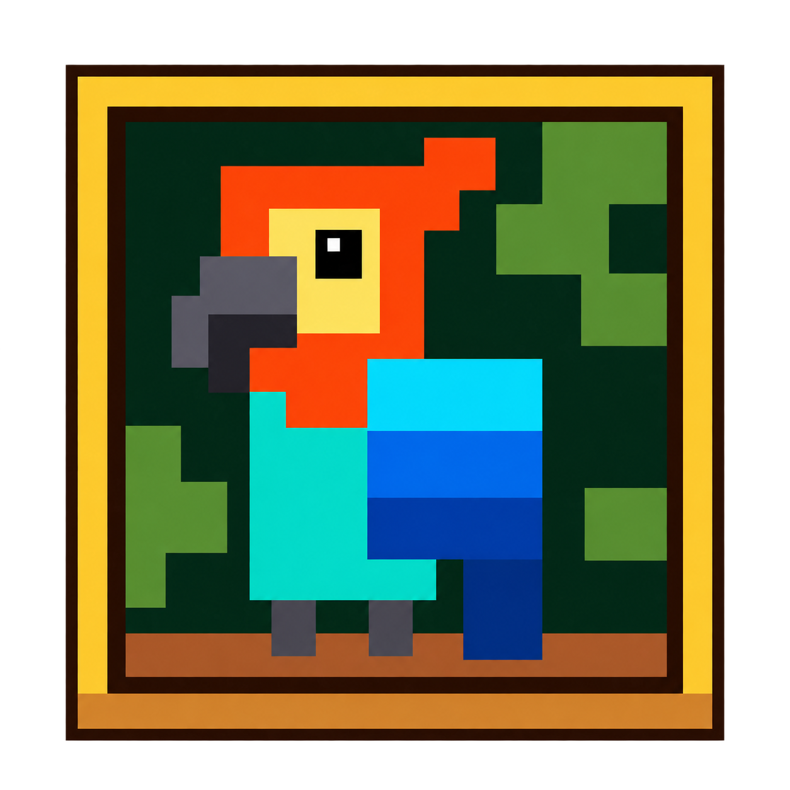

# PicaLens（鹊镜）



**实时放大 Wayland 会话中已打开的窗口，并内置 Gamescope 游戏启动器。**
PicaLens 读作 *PIE-kuh lens*。

---

## 桌面支持一览

PicaLens 在不同 Wayland 桌面上分为两种工作方式：
- **交互全屏**：由合成器后端直接渲染并换算输入坐标，可在放大画面中正常点击、滚动与操作键盘（支持原生 Wayland 与 XWayland 窗口）。
- **只读预览**：通过 XDG ScreenCast Portal 与 PipeWire 单窗流显示放大画面，仅用于观看与截图，不转发鼠标/键盘输入。

| 桌面 / 合成器 | 交互全屏 | 支持的 GPU 超分 | 说明与文档 |
| --- | --- | --- | --- |
| **KDE Plasma 6（KWin）** | 支持（内置） | 线性、FSR 1、SGSR、CAS、Sharp-Bilinear、xBRZ、CRT、Anime4K | 安装包自动匹配 KWin 6.3.6 / 6.7.5；支持快捷键直放大活动窗口 · [Plasma 指南](docs/kwin-experiment.md) |
| **GNOME 51** | 支持（内置扩展） | 线性 | 启用随包安装的扩展即可交互操作原生 Wayland 窗口；XWayland 需可选组件 · [见下方说明](#gnome) |
| **Hyprland 0.53.3** | 需专用插件 | 线性、FSR 1、SGSR | 未加载插件时可显式选择只读预览 · [Hyprland 指南](docs/hyprland-experiment.md) |
| **niri 26.04** | 需独立 fork | 线性、FSR 1、SGSR | 原版暂不支持交互，可显式选择只读预览 · [niri 指南](docs/niri-experiment.md) |
| **DDE Wayland（Treeland）** | 适配中（暂缓） | 线性、FSR 1、SGSR（实验） | 实验构建已在虚拟机验证，发行版自带版本待验收 · [Treeland 记录](docs/treeland-experiment.md) |
| **COSMIC / Sway / Denial** | 暂不支持 | — | 显式选择只读预览（若 Portal 提供单窗流）· [阻塞原因](#cosmicsway-与-denial) |

---

## 安装与升级

Ubuntu 26.10 和 Debian 13（amd64）共用同一个安装包。安装时会自动检测并启用与系统 KWin 版本匹配的后台组件。

从 [GitHub Releases](https://github.com/Love-in-idleness/PicaLens/releases) 下载 `.deb` 包后执行：

```sh
sudo apt install ./picalens_0.2.1-1_amd64.deb
```

> **提示**：Plasma 用户升级后请重新登录会话，以加载新版 KWin 后台；GNOME 用户首次安装后也需重新登录再启用扩展。

---

## 快速上手与核心功能

### 1. 放大已打开的窗口

1. 启动 `picalens`，在 **「放大」** 页选择缩放预设，点击 **「选择窗口」**。
2. 如需自定义缩放方式、滤镜、渲染显卡或 **画面裁剪（上/下/左/右逻辑像素）**，可在 **「缩放预设」** 页编辑或复制预设。
3. **按应用自动选择预设**：在 **「缩放预设」** 页可为指定 `app_id` 或 `WM_CLASS` 绑定预设；在 Plasma 6 或 GNOME 51 通过快捷键放大当前活动窗口时会自动应用匹配预设。
4. **缩放方式**：支持等比适应（默认）、裁剪铺满、拉伸铺满和整数倍缩放。
5. **截图与预览快捷键**：窗口化、整数倍与最近邻使用只读预览；预览期间按 `F11` 切换窗口/全屏，按 `F12` 保存截图，按 `Esc` 退出。在 Plasma 交互全屏或只读预览期间，也可执行 `picalens screenshot`（或将其绑定到桌面快捷键）一键保存截图。

### 2. 滤镜与渲染显卡

| 滤镜 | 类型 | 适用场景与特性 |
| --- | --- | --- |
| **线性 / 最近邻** | 基础 | 通用平滑缩放 / 保留硬边缘（最近邻走只读预览） |
| **Lanczos 3** | CPU（后台线程） | 按预览物理像素重采样，适合文字和普通画面 |
| **Scale2x** | CPU（后台线程） | 重建像素画斜边后以最近邻缩放；超过中间图像上限时回退为最近邻 |
| **FSR 1** | GPU 着色器 | 复用 [Gamescope 着色器](https://github.com/ValveSoftware/gamescope/tree/7d957c518081c27e95b0f2d3501237abc62bf4f5/src/shaders)，含 EASU 放大 + RCAS 锐化两阶段，支持调节锐化强度 |
| **SGSR** | GPU 着色器 | 复用 Gamescope 算法，单阶段空间超分，支持调节锐化强度 |
| **CAS（自适应锐化）** | GPU 着色器 | AMD FidelityFX CAS 对比度自适应锐化缩放，适合文字与通用画面，支持调节锐化强度 |
| **Sharp-Bilinear** | GPU 着色器 | 像素画锐利双线性缩放，在非整数倍率下兼顾清晰边缘与均匀像素比例 |
| **xBRZ** | GPU 着色器 | 任意倍率像素画平滑重建算法（Freescale 两阶段），适合经典像素游戏 |
| **CRT（复古显像管）** | GPU 着色器 | CRT-Easymode 扫描线与孔栅遮罩滤镜，还原复古显示器观感 |
| **Anime4K（轻量）** | GPU 着色器 | 复用 [Anime4K v4.0.1](https://github.com/bloc97/Anime4K/tree/v4.0.1)，组合高光限制、CNN 画面修复与按倍率启用的 2 倍超分 |

- **滤镜参数与后处理**：在 **「缩放预设」** 中可调节 **锐化强度（0–100%，默认 80%）**，并可为任意 GPU 滤镜按需开启 **后处理锐化（CAS）** 与 **去色带（Deband）**（适合视觉小说渐变画面）。
- **限制说明**：FSR 1 与 SGSR 着色器单边最多放大 2 倍，中间图像上限为 `3840×2160` 等量像素。启用交互全屏时，PicaLens 会自动检查后端与尺寸是否支持所选滤镜，不支持时会直接提示。
- **指定渲染显卡**：在放大预设的 **「渲染显卡」** 中，可为 GPU 滤镜指定执行设备（下一次放大生效）。Plasma 6 需支持此特性的 OpenGL 后端；提供单窗流的桌面也可在 Portal 预览中使用。

### 3. 通过 Gamescope 启动游戏

在 **「启动游戏」** 页可直接调用系统安装的 Gamescope：
- 支持保存 **Linux 原生** 或 **Wine** 启动配置，也可一键复制含 `%command%` 的 **Steam 启动选项**。
- 分辨率、滤镜、锐化、限帧、HDR、VRR、MangoApp 等选项会根据本机 Gamescope 版本自动检测可用性。
- 游戏通过 Gamescope 启动后可独立运行，不受 PicaLens 主窗口关闭影响。详见 [Gamescope 选项说明](https://github.com/ValveSoftware/gamescope#options)。

### 4. 外观、放大行为与快捷键

- **外观**：在 **「设置 → 外观」** 可切换跟随系统、浅色或深色主题（即时生效并保存）。
- **语言**：支持简体中文、English、日本語，默认跟随系统，切换后重启 PicaLens 生效。
- **放大行为**：在 **「设置 → 放大行为」** 可配置 **静止自动隐藏光标**（1 / 2 / 3 / 5 秒）、**放大期间防止息屏**，以及 **默认截图保存目录**（设置后按时间戳自动保存，无需每次弹窗）。
- **快捷键**：GNOME 和 Plasma 可在 **「设置」** 页直接修改全局放大快捷键；其他桌面可将自定义快捷键绑定到 `picalens toggle`，截屏可绑定 `picalens screenshot`。

---

## 各桌面使用说明

### KDE Plasma 6

- 兼容的 KWin 后台原生支持交互全屏，使用 OpenGL 合成时可启用全部 GPU 滤镜（原生 Wayland 与 XWayland 窗口均可用）。
- 使用交互全屏预设时，按下全局快捷键或运行 `picalens toggle` 会**直接放大当前活动窗口**，再按一次恢复。
- 如需手动指定其他窗口或使用只读预览，请从主界面点击 **「选择窗口」**。
- 构建与完整验收步骤见 [docs/kwin-experiment.md](docs/kwin-experiment.md)。

### GNOME

GNOME 51 Wayland 可直接使用随包安装的 Shell 扩展。首次安装后请先注销并重新登录，再执行：

```sh
gnome-extensions enable picalens@love-in-idleness.github.io
```

- **原生 Wayland 窗口**（含使用 Wine Wayland 驱动的游戏）：选择全屏预设并从 Shell 选窗后，即可直接点击、滚动与操作键盘；按 `Esc` 或切换快捷键恢复。
- **只读预览**：窗口化、整数倍、最近邻使用 Portal 只读预览；扩展未启用时也可显式选择 Portal 只读预览。

#### GNOME 下的 XWayland 交互（可选组件）

已验证环境为 Ubuntu 27.04 的 Mutter `51.0-1ubuntu3`。该可选组件仅作用于当前用户会话，随 GNOME Shell 启动并为放大中的 XWayland 窗口换算鼠标坐标；若系统升级导致 Mutter 版本不匹配，Shell 会自动回退到系统库。未安装此组件时，可使用「只读全屏预览」查看 XWayland 窗口。

- **安装**：解压版本匹配的 `picalens-gnome-xwayland_*.tar.gz`，运行 `./install-user.sh` 后注销并重新登录。
- **卸载恢复**：删除安装脚本输出的 systemd 用户配置文件，执行 `systemctl --user daemon-reload` 后重新登录即可恢复使用系统库。
- **自行构建**：启用系统源码仓库，安装 Mutter 构建依赖与 `patchelf`，下载对应 `libmutter-51-0` 的源码包后运行：
  ```sh
  bash packaging/build-gnome-xwayland.sh /path/to/mutter_51.x.dsc
  ```
  构建产物输出至 `build/deb/`。

### niri 与 Hyprland

- **交互放大**：
  - **niri 26.04**：需使用独立 fork 中的交互后台，见 [docs/niri-experiment.md](docs/niri-experiment.md)。原版 niri 26.04 暂不支持交互，请使用只读预设（[原版桌面复测](docs/verification.md#原版桌面交互复测)）。
  - **Hyprland 0.53.3**：需加载匹配的后台插件，见 [docs/hyprland-experiment.md](docs/hyprland-experiment.md)。
  - 两者均支持等比全屏（线性 / FSR 1 / SGSR），原生 Wayland 与 XWayland 输入均已在隔离会话通过验证。
- **只读预览**：通过 ScreenCast Portal 选窗与 PipeWire 单窗流工作（niri 使用 `xdg-desktop-portal-gnome`，Hyprland 使用 `xdg-desktop-portal-hyprland`）。旧版 Hyprland 选窗器若有多个来源标签，请切换到 **Window** 再选应用。详见 [验收记录](docs/verification.md#niri-与-hyprland-单窗放大)、[niri 采集文档](https://niri-wm.github.io/niri/Screencasting.html)、[Hyprland Portal 文档](https://wiki.hypr.land/hypr-ecosystem/user/xdg-desktop-portal-hyprland/)。
- **绑定切换快捷键**（首次触发选窗，再次触发结束放大）：
  - **niri**（`binds` 中）：`Mod+F8 { spawn "picalens" "toggle"; }`
  - **Hyprland（Hyprlang）**：`bind = SUPER, F8, exec, picalens toggle`（Lua 配置可将同一命令绑定到执行调度器）

### DDE Wayland（Treeland）｜适配中

DDE Wayland 的交互全屏仍在适配中（当前暂缓开发）。实验构建已在虚拟机中验证，发行版自带的 Treeland 仍待验收；若系统 Portal 提供窗口采集，可使用只读预览。详见 [docs/treeland-experiment.md](docs/treeland-experiment.md) 与 [Treeland 功能讨论](https://github.com/linuxdeepin/treeland/issues/1728)。

### COSMIC、Sway 与 Denial

在这三个原版 Wayland 会话中选择交互全屏时，PicaLens 会提示 **「当前桌面暂不支持交互放大」**。若会话的 ScreenCast Portal 提供单窗流，请显式选择只读预览（详见 [原版桌面交互复测](docs/verification.md#原版桌面交互复测)）。

| 原版 Wayland 会话 | 交互放大 | 阻塞原因 |
| --- | --- | --- |
| **COSMIC Epoch 1.11.0** | 暂不支持 | 可同时取得单窗流与输入权限，但单窗流缺少 EIS 定位所需的 `mapping_id` |
| **Sway 1.12（wlr Portal 0.9.0）** | 暂不支持 | 两类窗口均可采集，但虚拟输出试验中原生 GTK 窗口未绑定临时座席 |
| **Denial 0.6.10** | 暂不支持 | 官方包使用 wlr Portal 提供屏幕共享，缺少 RemoteDesktop 后端 |

---

## 开发与构建

### 本地构建

**构建依赖**：Rust ≥ 1.89、C 编译工具链、`libclang`、`pkg-config`、GTK ≥ 4.14、libadwaita ≥ 1.4、PipeWire 开发库。

```sh
cargo build --locked
target/debug/picalens
```

- 桌面启动器位于 [`data/`](data/)。本地安装时确保 `picalens` 在 `PATH` 中，并将 `.desktop` 文件放入桌面应用目录。
- Plasma 交互模式需另行部署匹配的 KWin 后台插件（见 [docs/kwin-experiment.md](docs/kwin-experiment.md)）。

### 构建统一 Debian 安装包

1. 分别在 **Debian 13** 和 **Ubuntu 26.10** 上运行 `bash packaging/build-kwin.sh`。
2. 将两处生成的 `build/deb/kwin-backends/` 子目录汇总至 Debian 13 同一目录。
3. 在 Debian 13 运行 `bash packaging/build-deb.sh`，产物与校验文件将输出到 `build/deb/`。

完整依赖与自动化发布流程见 [.github/workflows/deb-preview.yml](.github/workflows/deb-preview.yml)。

### 技术验证与测试工具

仓库内置原生 Wayland / XWayland 测试源窗及 Portal / EIS 探针，便于复现与回归测试：

```sh
target/debug/picalens-test-window             # 启动原生 Wayland 测试源窗
target/debug/picalens-test-window --xwayland  # 启动 XWayland 测试源窗
target/debug/picalens-probe                   # 运行 Portal 捕获与输入探针
```

**当前验证覆盖**：
- KWin 6.3.6（QPainter）：原生 Wayland 与 XWayland 在 100% / 150% 缩放下的线性交互。
- KWin 6.7.5（DRM/OpenGL 虚拟机）：原生 Wayland 与 XWayland 的 FSR 1、SGSR、Anime4K 交互及渲染显卡选择。
- GNOME 50.1 / 51：Portal 只读捕获、Shell 扩展原生交互及 Mutter 补丁 XWayland 交互。
- **待验证**：GPU 滤镜在物理显卡上的实际性能与真实双 GPU 切换。详细记录见 [docs/verification.md](docs/verification.md)。
